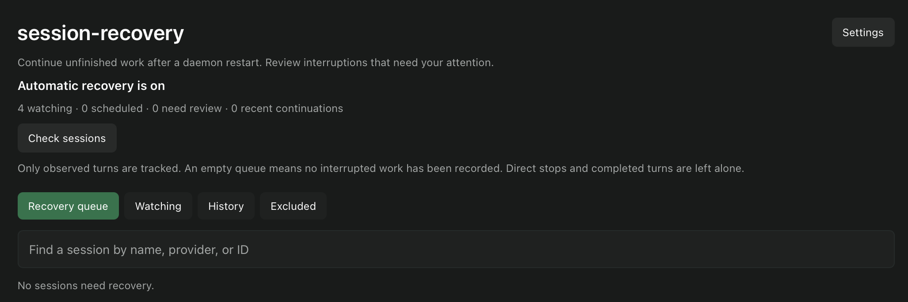

session-recovery tracks running Paseo turns and continues unfinished sessions after the daemon restarts. It starts tracking with the next observed turn. Existing idle sessions are left alone.

Automatic recovery is on by default for main sessions, with a 60-second delay, up to three attempts per interruption, and a 24-hour recovery window. The delay doubles after each attempt, up to 15 minutes. Subagent recovery and retries for recognized temporary provider errors can be enabled separately.

The recovery screen shows scheduled continuations, sessions that need review, exclusions, and recent activity. You can preview a continuation before sending it manually, dismiss a candidate, or exclude a session from future recovery. Stopped turns, completed turns, questions, and approvals are excluded from automatic recovery. Uncertain delivery requires checking the conversation.

Recovery starts a new turn in the existing conversation using its current provider and settings. The message asks the agent to check existing work before repeating commands or external actions. It cannot restore an interrupted process. Lifecycle events are best effort, so an interruption cannot always be classified. Paseo 0.11 has no atomic send-if-idle request; the plugin rechecks before submission, but a concurrent action can still race it.

Requires a macOS or Linux daemon running Paseo 0.11.4 through 0.11.x and a provider with saved history. Only Paseo-managed sessions are covered. The paired session-janitor 0.1.2+ protects pending recovery from cleanup; other cleaners do not read those protections. Metadata and recovery records stay on the daemon with owner-only permissions. Continuations use the existing session and provider.
