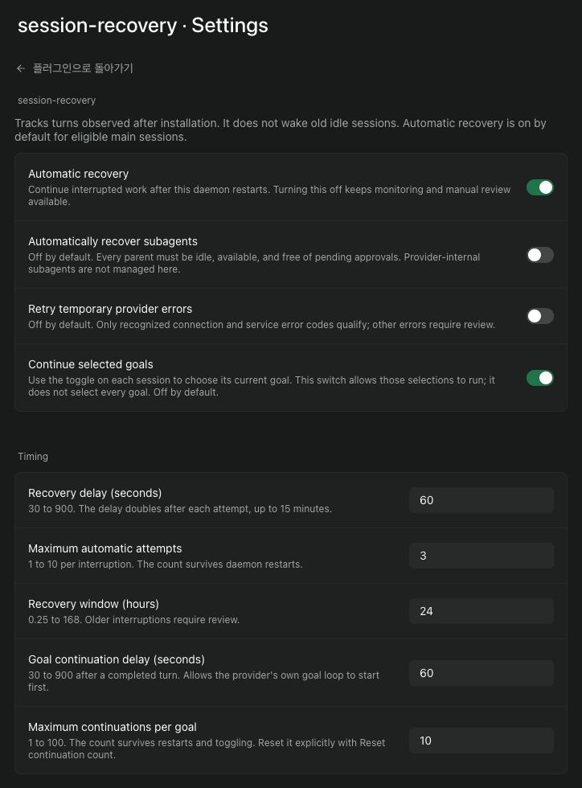

# session-recovery

Recover interrupted Paseo sessions after a daemon restart. Preview the current goal above the composer, press its text to edit, and pause or resume supported native goals. Optional Paseo continuation follows only the goals you select.



## Defaults

| Setting | Default |
| --- | --- |
| Automatic recovery | On for eligible main sessions |
| Initial delay | 60 seconds |
| Maximum attempts | 3 per interruption |
| Recovery window | 24 hours since last observation |
| Automatic subagent recovery | Off |
| Temporary provider error retries | Off |
| Goal continuation | Off; each session also needs an explicit selection |
| Interrupted goal recovery | Off; selected goals only |
| Goal continuation delay | 60 seconds |
| Maximum goal continuations | 10 per objective |

The delay doubles after each attempt, up to 15 minutes. Attempt counts survive daemon restarts. A normal completion or an explicit stop ends the recovery incident.

## Review and control

Open **session-recovery** in the sidebar. Settings are in the upper-right corner and under Paseo's plugin settings.

The sidebar shortcut is hidden in the iOS and Android apps. Use **Open session-recovery** in the Command Center to open it there. The per-session Goal preview and supported controls remain available.

- **Recovery queue:** scheduled continuations and interruptions that need review.
- **Watching:** observed turns, including pending user input.
- **Goals:** recorded goal states and their continuation counts.
- **History:** completed, stopped, and dismissed records.
- **Excluded:** sessions excluded from recovery.

**Goal** appears beside Tasks and Subagents for Codex, OMP, Pi, Claude Code, and OpenCode sessions, including on iPhone and Android. A mounted native composer shows a shortened objective. Press the text to open the prefilled editor in an anchored popover on desktop or a bottom sheet on mobile. Viewing it never selects or starts a goal. Without a verified objective, **Goal** remains available for inspection. OMP previews query the owning RPC connection when available and otherwise read its known session file. Reading never restores a provider process. Pi goal history is inspected explicitly. The objective popover omits playback controls; use the separate Pause, Resume, or Start goal button beside it.

Verified Codex goals have a separate **Pause / Resume** button. It changes the native goal state, preserving its budget and usage, and a current turn may finish after pausing. OpenCode controls require an idle session. Its resume button opens the editor. A short budget-reset notice appears above **Resume**, which explicitly starts the native plugin's new budget window. Manual edit, pause, and resume are not blocked by token or elapsed-time calculations in this plugin. The provider handles its own limits. Claude uses session execution controls: Pause stops the current turn and Resume continues the existing goal. OMP uses its native Goal RPC when the daemon companion is installed. Pause stops goal continuation; a current turn may finish. Resume preserves the goal identity, objective, token budget, and usage. Older conversation-only requests show **Start goal**, which explicitly creates a native OMP goal. It appears only after the owning OMP connection confirms that no native goal exists. If the connection is unavailable and only an older request is known, the objective remains visible with unknown state and creation stays unavailable. Viewing a request never starts it. OMP no longer uses a continuation chat message for goal controls.

**Details** in the editor has a separate **Extra continuation · On / Off** setting. Goal sessions also have a toggle on their recovery card. Turning this selection off cancels that goal's pending fallback continuation while keeping interruption recovery available. Native pause or resume clears the fallback selection; choose it again if desired. These controls do not turn off a provider's native loop.

Turning the toggle on explicitly resumes a **blocked Codex goal**, then schedules its next continuation after the configured delay. For a goal already selected before this update, turn it off and on once to resume it. The goal's objective, token budget, usage, and continuation count are preserved. Pending input, an explicit session stop, and exhausted limits still prevent resumption. With Recover interrupted goals enabled, an observed temporary provider error can also qualify for automatic Codex resumption. Other blockers still require review.

You can turn it on during a running turn. The native goal command leaves that turn running. When idle, Codex may start its own goal turn immediately after resumption. The plugin waits for that turn to finish and the configured delay to pass before sending a fallback continuation.

Paseo must list its native `/goal` command for the session before the toggle can resume a blocked Codex goal. Custom launch wrappers must return the Codex version when the wrapper itself is run with `--version`. After fixing a wrapper, reload affected sessions in Paseo when idle. The plugin checks command support before sending and leaves running sessions in place.

Paused, limited, and non-Codex blocked goals can be selected without changing their native status. The plugin rechecks selected goals and waits for the same objective to become active.

**Resume…** previews the continuation message and rechecks the session before sending it. **Dismiss** ends a pending recovery and releases its cleanup protection. **Exclude recovery** also excludes future turns until you allow them again. Command Center has per-session exclusion and inclusion actions.

Turning automatic recovery off leaves monitoring and manual review available. Settings are shared by clients connected to the same daemon.

## View and edit a goal

Press the goal preview to edit its text in place. In a native Codex, OpenCode Goal-mode, or Claude Code session, you can also enter `/goal`, `/goal edit`, or `/goal-edit`, or choose **View or edit this session's goal** in the Command Center to open the full goal screen. Both editor surfaces prefill the current objective and show its native state and reported token usage.

| Provider | Save behavior |
| --- | --- |
| Codex | **Save**. Sends native `/goal <objective>`, preserving the goal budget and usage. Codex's own loop may start work. |
| OpenCode | Uses native `/goal edit <objective>`, preserving the focused goal ID, turn/token/time budgets, usage, and history. Paused/blocked goals become active and native work starts. Requires opencode-goal-plugin's version 1 session state and its registered `/goal` command. |
| Claude Code | **Replace & start** sends native `/goal <condition>` and immediately starts a turn. Claude replaces the condition and resets its goal timer, evaluated turn count, and token-spend baseline. Claude exposes no separate goal token budget. |

OpenCode and Claude edits require an idle session because their native commands start work. Completed goals, unavailable state, pending approvals, and uncertain delivery are read-only. Controls remain visible but disabled while waiting for an eligible idle session. The reason and Reload are shown directly in the editor. Provider limits are enforced by the native command, not by a second UI usage check. The editor checks the native result and never retries an unconfirmed edit automatically. OpenCode and Claude conditions are limited to 4,000 characters; Codex allows 16,000 in this editor.

Claude reads native `goal_status` attachments in the selected session's JSONL transcript, following the current parent chain to exclude abandoned branches. It inspects at most the last 8 MiB; incomplete, changing, missing, or unrecognized state is read-only. `CLAUDE_CONFIG_DIR` from the inherited provider environment is supported. A launch wrapper or hook that privately changes that directory must expose the same path in the provider environment. Token usage, when present, is from the last native goal evaluation. The plugin does not change Claude's hook settings or trust policy. Its native `/goal` command must be available and allowed by those policies.

Saving rechecks the native objective, state, identity, budget, and the session before sending. Edit and native control tickets expire after five minutes and are consumed once. These checks reduce stale overwrites; Paseo does not expose an atomic conditional goal update. Native controls record intent before submission; uncertain delivery requires review and is never automatically retried. The new objective is not automatically selected for Paseo continuation. Select it again if desired. Opening the editor never selects a goal or starts work. Only mounted composers read objective previews; Pi history inspection is explicit. Objective text and tickets are not written to the recovery journal.

Nonempty `/goal` arguments other than `edit` retain their native behavior, including `/goal pause`, `/goal resume`, and `/goal clear` where supported. Other providers retain their native `/goal` and `/goal edit` behavior. OMP editing is unavailable because its current goal RPC does not expose an objective update; the editor does not replace it by clearing and recreating a goal. For older OMP conversations where `/goal` was delivered as a normal prompt, the preview tracks the latest explicit user request on the current conversation branch. Press **Start goal** to register that request as a native OMP goal while the session is idle. Native records take precedence when present. OMP controls use native RPCs and never send a continuation chat message. Claude uses execution controls: Pause interrupts the current turn, and Resume sends one continuation in the same conversation while keeping the objective. Resume requires no pending approval and an idle session. These controls never send `/goal pause` or `/goal resume` to Claude and work independently of extra automatic continuation.

## Goal continuation

Enable **Continue selected goals** in settings, then open the goal's **Details** and turn **Extra continuation** on for that session. The settings switch is a master control; turning it on does not select any goals. You can also select an existing session from the Command Center.

After a normal turn ends, the plugin checks the goal, waits for the configured delay, then checks again before sending a continuation. If the provider has already started its own next turn, the plugin leaves that turn running.

Codex goals are read through the official `thread/goal/get` API. A local subprocess uses the configured Codex command and environment. It only initializes and reads goal state; it never loads a thread or starts a turn. Turning the toggle on for a blocked goal sends Paseo's native `/goal resume` command through the owning daemon. That command updates only the status through Codex's goal API. A separate process cannot safely update a thread held by Codex's active writer. The plugin records the command intent and waits for the same objective to become active before scheduling a continuation. Unconfirmed delivery requires review and is not retried automatically. Codex must support these goal APIs. An unavailable or unrecognized response requires review.

OpenCode uses the **Goal** agent mode supplied by [opencode-goal-plugin](https://github.com/william-ricchiuti/OpenCode-goal-plugin). The plugin reads that mode's focused objective from its version 1 native session snapshot. Choosing Goal mode alone does not create an objective; set one with `/goal <objective>` first. Build, Plan, unrelated custom modes, and background or queued objectives are excluded. Leaving Goal mode blocks pending goal continuation. A renamed goal agent is supported when it retains the upstream mode registration.

OpenCode already has its own goal loop. This toggle controls Paseo's fallback messages; turning it off does not pause OpenCode's own loop. A native continuation claim or child-session guard prevents an extra Paseo message. Native pauses, blockers, restarts, and limits are respected. Use OpenCode's `/goal pause` to pause its loop. Review a stopped goal before using `/goal resume`, which starts a new native budget window. This plugin never sends those control commands or resets native budgets automatically.

OpenCode's configured Goal command and agent must reference an available model. A stale command/agent model can fail before the native goal is created even when the session has a different model selected.

OpenCode state is read from `<session cwd>/.opencode/goals/state.json.sessions/<hashed native session ID>/state.json`, or the corresponding location under `OPENCODE_GOAL_STATE_PATH` in the provider environment. Custom providers extending OpenCode are supported. Snapshots are bounded to 2 MiB and checked against the native lifecycle ledger's modification time. Missing, changed, malformed, unsupported, or outdated snapshots require review. Persistence must be enabled. Legacy global state and JavaScript-only `stateFilePath` overrides are not discovered; expose a custom location through `OPENCODE_GOAL_STATE_PATH`. The upstream source and state format were used as the integration reference; the reader does not import or execute the upstream plugin.

OMP reads native goal state from its existing RPC connection when available. Offline previews inspect the known saved session file, with bounded reads and incremental updates. A native goal takes precedence over an older explicit `/goal` request on the current branch. Pi inspection reads structured `goal`, `create_goal`, `get_goal`, and `update_goal` tool results in at most the most recent 2,000 canonical timeline entries. Ordinary chat text, plans, and to-do lists are not treated as goals. An unverifiable state requires review.

Claude previews read the selected composer's native transcript only, bounded to its last 8 MiB. The editor and Command Center can inspect that same session explicitly. A selected Claude goal receives a fallback only when no turn is running and the configured delay has passed. A recorded user stop still prevents automatic continuation.

Automatic composer discovery reads supported goal state without restoring a conversation. Older OMP requests require **Start goal** in the editor before they can be selected; their native loop owns continuation. For Pi and other providers that expose goals through conversation records, use **Continue this session's goal** in the Command Center to inspect and select one explicitly. Selected goals keep their automatic checks before continuation. Their composer toggle can show the last checked state without loading the conversation. Concurrent background checks for the same session share a result; sessions without a visible goal are checked again after five minutes or a relevant session change.

Paused, completed, cleared, and limited goals are not automatically resumed. Blocked goals require an explicit action unless the Codex temporary-error recovery described below applies. Selecting fallback continuation can also reactivate a blocked Codex goal after its checks. Questions, approvals, direct stops, exclusions, and uncertain delivery also block automatic continuation. The continuation message asks the agent to verify its work before marking the goal complete. The plugin cannot independently prove that a provider's completed goal was actually achieved.

Selection is tied to the current objective in that session. A different objective, completion, or clearing the goal removes the selection. Existing goals from earlier plugin versions start unselected. An unselected goal does not create a cleanup hold just because it remains active.

The per-objective limit survives turns, daemon restarts, and cycling the toggle. A different objective gets a new count. Recreating the same objective retains its count; **Reset continuation count** at the limit explicitly resets it. Turning a session toggle off cancels pending goal continuation, and leaves active turns, uncertain delivery, approvals, and ordinary interruption recovery intact. No provider settings are changed.

## Recover interrupted goals

Enable **Continue selected goals** and **Recover interrupted goals** in settings, then select the goal under **Details → Extra continuation** in each session. Recover interrupted goals starts off and requires the session connection companion for the verified Paseo 0.12.0 build. It does not select goals or switch models.

- **Temporary provider error:** wait for the recovery delay, then verify the same goal and session. A Codex goal that became blocked after a recognized temporary failure can be resumed through its owning native connection, preserving identity, budget, usage, and the existing selection. A blocker without that observed error stays in review. Active goals can continue in the same session.
- **Daemon restart:** reconnect selected active goals to their saved sessions, including goals that had no live turn when the daemon stopped. The connection companion is required. The provider gets time to restart its own loop before any fallback is considered.

The default recovery delay is 60 seconds, doubling after each attempt up to 15 minutes. At most three attempts are made per interruption, also subject to the goal continuation limit and recovery window. Counts survive turns and daemon restarts. Each scan starts at most three due recoveries; it reads tracked sessions only.

Recognized service/connection codes work across providers. Codex's exact “Selected model is at capacity. Please try a different model.” message is also recognized when Paseo omits its code. Raw error text is not saved. Authentication failures, unavailable models, quota/rate limits, user stops, questions, approvals, new messages, and uncertain delivery prevent automatic recovery. Paused and budget-limited goals stay stopped. OpenCode resume starts a new native budget window, so the plugin never issues it automatically. OMP receives no continuation chat message; its native loop owns continuation.

The separate **Retry temporary provider errors** switch applies to ordinary session recovery. Selected-goal recovery uses **Recover interrupted goals** and its session selection instead. A completed turn ends the current recovery incident. Disabling a session's selection cancels its pending goal recovery. Ordinary recovery of an observed unfinished turn still follows Automatic recovery.

## Recovery rules

When a native goal is still active but its session is stopped, the playback button shows **Resume** with a play icon. On a daemon with the connection companion, it reconnects the existing session without pausing the goal, resetting its budget, or enabling extra continuation. The editor uses the same action. A stale Pause response is disabled as soon as stopped session metadata arrives.

Explicit stops and completed goals are never automatically resumed. A completed turn is only continued when goal continuation is enabled, the current goal is selected, and that goal is still active. Pending questions and approvals require user input. Archived or missing sessions, unavailable history, and unavailable workspaces are excluded. Subagent recovery checks every parent; an active, archived, missing, or excluded parent blocks it. Provider-internal subagents are outside this plugin's scope.

Unknown interruptions go to review. Temporary provider errors are retried only when enabled and when their code is recognized. Codex's exact "Selected model is at capacity. Please try a different model." error is also recognized when Paseo omits the error code. This uses the same delay and attempt limits and continues the existing session without switching models. Uncertain delivery is not automatically retried, even after another restart. Open the conversation to check the result.

Worker birth times distinguish daemon restarts from plugin reloads, including when the supervisor stays alive. Graceful shutdown detection uses Paseo 0.11.4 and 0.12.0's removal of the local credential before closing sessions. A runtime close without shutdown evidence requires review.

An active goal is saved intent, not proof of a running turn. With the session connection companion installed, selected active goals can reconnect their existing provider after a daemon restart or an observation gap. The plugin opens the same saved session through Paseo's shared loader, then waits for the provider's native turn before considering a fallback message. It does not cycle Pause/Resume, create a replacement goal, or reset its budget. Reconnection counts toward the selected goal's continuation limit. User stops, pending input, changed conversations, exclusions, and uncertain delivery still block recovery. Goals that are not selected keep the ordinary interruption rules.

Lifecycle hooks are live and best effort. Missed events can leave an interruption unclassified. The plugin checks the latest completion, activity, permissions, archive state, and conversation timestamp before recovery. Paseo 0.11 and 0.12 have no atomic send-if-idle request, so a concurrent user action can still race submission. The request uses steering if a turn starts concurrently; providers may fall back to replacing a turn. Exclude sessions where this tradeoff is unacceptable.

Recovery starts a new turn using saved conversation history and current project state. The default message asks the agent to check existing work before repeating commands or external actions. It cannot restore a killed process or guarantee that an external action will not be repeated. Normal provider usage and billing apply.

## Cleanup integration

The paired **session-janitor 0.1.2+** reads the recovery protection list. Unresolved recovery protects sessions and their descendants from cleanup and manual tree deletion. Dismiss or exclude a candidate to release it. Protections remain if recovery is disabled or removed; resolve the candidates before removing it.

Other cleanup scripts do not read this list. Their configuration is not changed.

## Install locally

Requires a macOS or Linux daemon running **stable Paseo >=0.11.4 <0.13.0** and a provider with persistent history. The UI supports compact clients.

```sh
npm ci --ignore-scripts
npm run typecheck
paseo plugin install /absolute/path/to/paseo-session-recovery
```

Reload changes with `paseo plugin reload session-recovery`. A daemon restart is not needed. Goal entries retry a failed initial session lookup and rebuild after reconnecting, including on mobile clients. A supported provider entry is registered before any goal-state request. Goal checks run for mounted composers, rather than scanning every saved session on each connected client.

For a direct Git installation, use `paseo plugin add git:sm1ee/paseo-session-recovery --ref v0.6.11`. The public registry listing requires a separate review.

### Session connection companion

Paseo 0.12.0 does not expose a plugin API to reconnect an unloaded session without sending a message. `scripts/build-session-connection-companion.mjs` generates a version checked daemon adapter from an absolute output directory and an optional server source directory. Its `preload.cjs` exports `install()`, which the daemon operator loads from the existing bootstrap before session modules load. Packaged macOS builds need an Electron Node runner to read `app.asar`. An optional fourth argument supplies an existing lightweight workspace status adapter; its hash is checked too. The adapter preserves the existing workspace update queue.

The companion treats a stored `running` value as historical state and reports that session as stopped until its live connection returns. Persisted native child records do not count as current workspace activity when their owning connection is absent. These are display projections; native history and saved lifecycle records are left intact. Goal previews show **Stopped**, **Idle**, or **Error** when the observed session is not running, even if the native goal remains active. Reading a preview never opens a provider.

Without this companion, automatic recovery keeps the existing metadata checks and may require review for unloaded sessions. The adapter accepts only the verified Paseo 0.12.0 sources; a Paseo update requires another compatibility check.

## OMP native controls

Paseo 0.12.0 does not expose OMP Goal RPCs to plugins. Native OMP controls require the included daemon companion, which forwards requests over that session's existing connection. Its source checks accept only the verified Paseo 0.12.0 build. The plugin alone cannot add this path on another host; without the companion, OMP goals remain available for viewing.

`scripts/build-omp-companion.mjs` takes an absolute output directory and an optional Paseo server source directory. It generates a small `preload.cjs` with an `install()` function, the compiled companion, and a manifest of verified hashes. A daemon operator loads that function from the existing daemon bootstrap before provider modules load. Packaged macOS builds require an Electron Node runner that can read `app.asar`. This is a local compatibility adapter, not an upstream Paseo API. A Paseo update needs a new compatibility check.

OMP must allow native RPC continuation. Keep the desired existing modes and include `rpc` in `goal.continuationModes`, for example `["interactive", "rpc"]`. OMP still stops for its own blockers, explicit pauses, completed goals, limits, and host aborts. Extra Paseo continuation never supplies additional OMP goal messages.

Native controls do not edit, drop, or recreate an existing goal. Starting an older request creates a new native goal only after **Start goal** is pressed. OMP currently has no RPC for editing an existing objective. A dormant session is reopened through Paseo's shared loader for an explicit action or a verified, selected-goal recovery. Preview reads never reopen it. A missing saved model is reported for the user to replace in Paseo; the plugin does not switch models or retry an uncertain operation automatically.

## Local data

Session IDs, titles, providers, turn IDs, timestamps, attempt counts, exclusions, goal fingerprints, selections, states and mode IDs, and recent outcomes stay under `plugin-data/session-recovery/` in the daemon's Paseo home. `state.json` is the journal, `holds.json` is the cleanup protection list, and `worker.lock` prevents duplicate monitors. Files use owner-only permissions. Journal writes use sync and atomic rename.

Composer visibility checks, goal continuation, and explicit goal selection inspect supported goal state and conversation records in memory. Connected clients observe the metadata directory of unarchived sessions in active workspaces to register Goal entries. Only mounted supported-provider composers query current goal state, with up to four concurrent requests. Verified goals are checked about every 15 seconds; an unavailable goal state is checked again after five minutes or a relevant session change. Opening the goal screen explicitly inspects that one session, including supported OMP/Pi conversation records and Claude native state. Other providers may discover compatible goals through their existing metadata checks. The daemon briefly caches these read-only results. Discovery does not select, schedule, or resume sessions, and still works when the automatic continuation setting is off. Conversation bodies, goal objectives, raw provider errors, API tokens, and credentials are not stored in the journal. The local credential is read in memory to authenticate to the owning daemon's loopback listener or Unix socket. Continuations go through the session's existing provider. No separate model or external review service is used.

The startup connection uses a version-pinned adapter because Paseo does not provide an SDK context at plugin entry startup. Stable 0.11.4 through 0.12.x are supported. On 0.12, workspace lookups include background workspaces. Unknown versions and prereleases pause recovery until compatibility has been checked.

A Paseo update does not normally require a plugin update. This plugin checks its daemon adapter more closely because it relies on the daemon's credential and process lifecycle. CI checks both the 0.11.4 and 0.12.0 plugin SDKs.

## Development

```sh
npm ci --ignore-scripts
npm run typecheck
npm run test:mobile
npm test
```

Tests simulate restarts, stops, approvals, lost responses, retry limits, concurrent user actions, and storage failures. They do not restart the real daemon or resume user sessions.

The mobile check compiles the client module graph with React Native's Hermes compiler without running plugin code. CI runs it with both supported Paseo SDK versions.

### Lightweight goal inspection

Goal previews and the editor read native goal state without restoring conversation history or checking slash commands. Concurrent reads of the same editor share one request. Native commands and session identity are checked again before saving, pausing, or resuming. Background checks do not load history; if a selected goal cannot be verified from native state, automatic continuation waits for review.
